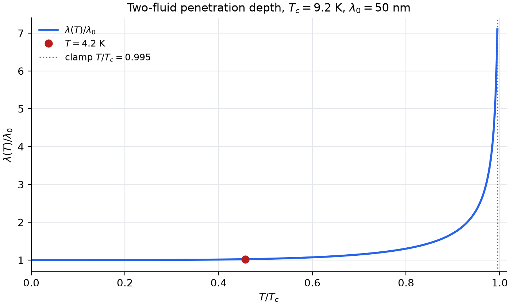
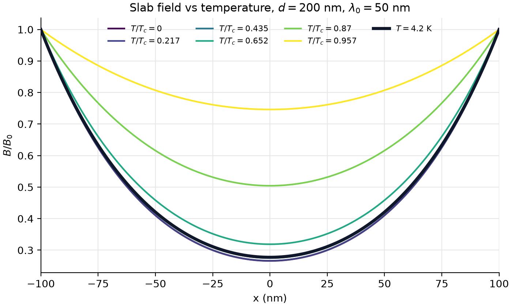
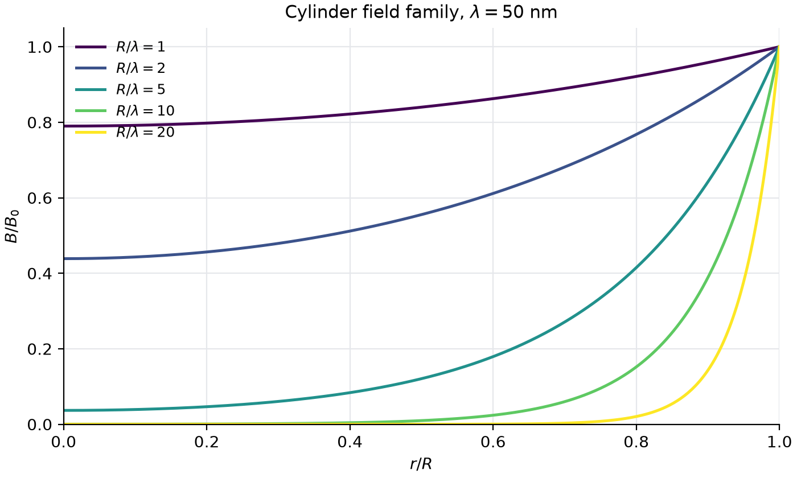
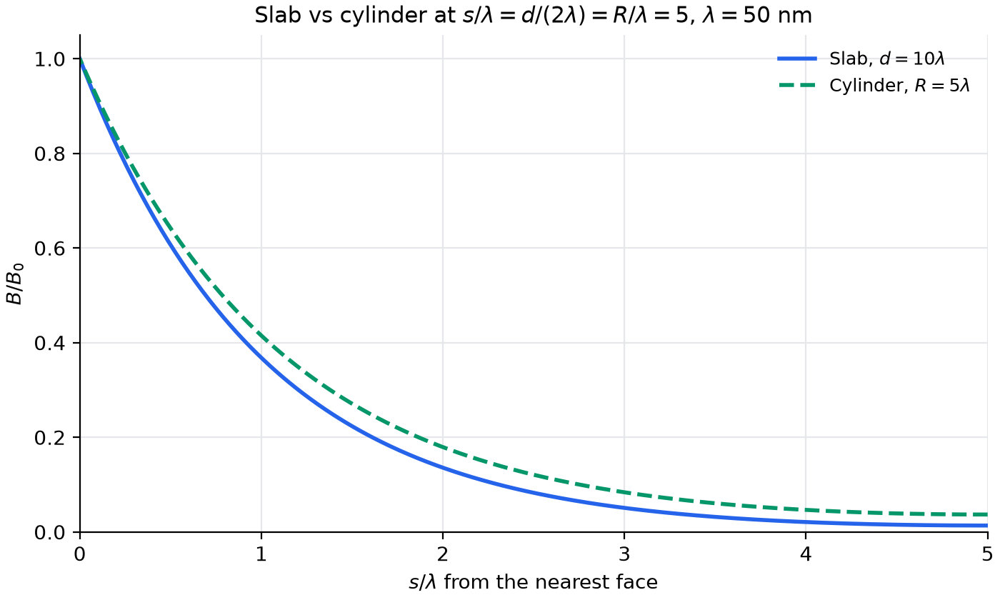
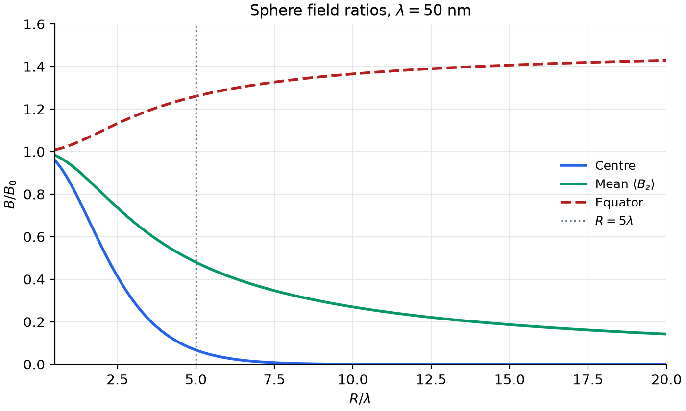
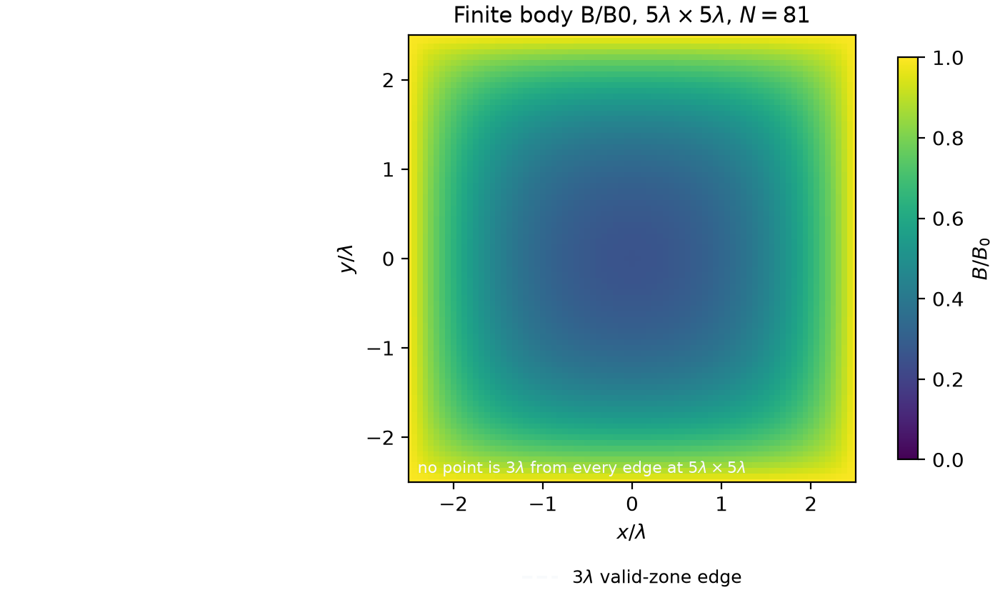
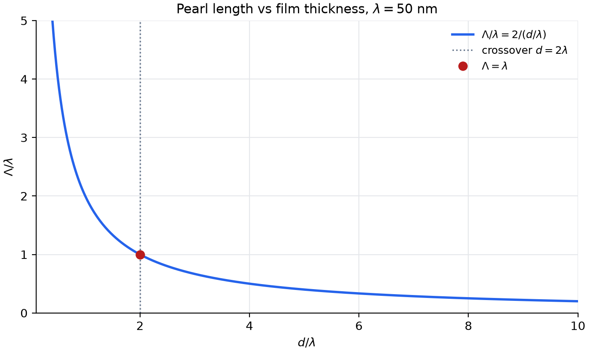

## 1. Abstract

A superconductor expels a static magnetic field and screens the interior over the London penetration depth $\lambda$. This report explains that screening from the field equation to a working simulator. It collects the theory, three numerical methods and an analytic reference, five geometry models, and an interactive app in one document.

The theory starts from the London equations and the Meissner effect. A two-fluid law gives $\lambda(T)$, and a temperature clamp keeps the law finite near the critical temperature. The report covers five geometries. The slab and the axial cylinder have closed forms in $\cosh$ and modified Bessel functions. The sphere has an exact vector solution. The thin film follows the Pearl length. The finite rectangle needs a scalar solver.

The finite difference, relaxation, and shooting methods reproduce the slab answer on one grid. Finite differences and relaxation hold a relative error near $2.8 \times 10^{-6}$. Shooting holds $1.5 \times 10^{-10}$. Every method stays below the $10^{-3}$ target. The geometry checks match the closed forms to the reported digits.

Screening weakens as $s/\lambda$ falls, and a rise in temperature increases $\lambda$ and flattens the profile. The app has eight pages, one material card per page, a physical or ratio size mode, and a field map for each page. Each of the eight pages passes an automated app test.

## 2. Scope and deliverables

The work answers one question. How does a static magnetic field decay inside a superconductor, and how do geometry and temperature change that decay?

The deliverables are these:

- A theory statement for the London equations, the Meissner effect, the penetration depth, and the two-fluid temperature law.
- Numerical techniques for the one-dimensional slab, with an error metric and a target.
- Geometry models for the slab, cylinder, sphere, finite body, and film, with governing equations, boundary conditions, and valid limits.
- A shared numerical solver for a finite rectangle.
- An eight-page interactive app with per-page controls and field maps.
- Automated checks for the figure script, the field maps, the app pages, and the module imports.
- Figures that record the profiles, the errors, and the geometry checks.

The report stays inside the local London model at a static field. It does not treat vortices, disorder, or time-dependent fields.

## 3. Theory

### 3.1 London equations and the Meissner effect

London and London replaced the current density of the superconducting state with two equations [1]:

$$\frac{d\mathbf{J}}{dt} = \frac{n_s e^2}{m}\,\mathbf{E}, \qquad \nabla \times \mathbf{J} = -\frac{n_s e^2}{m}\,\mathbf{B}.$$

The first equation says that a steady current flows with no electric field. The second equation ties the curl of the current to the field. Ampère's law, $\nabla \times \mathbf{B} = \mu_0 \mathbf{J}$, then gives a field equation inside the metal:

$$\nabla^2 \mathbf{B} = \frac{\mathbf{B}}{\lambda^2}, \qquad \lambda = \sqrt{\frac{m}{\mu_0 n_s e^2}}.$$

The depth $\lambda$ is the length over which the field falls by a factor $e$. It is a mesoscopic length. For one carrier per atom, $\lambda$ is of order 20 nm to 40 nm in a conventional superconductor. Tinkham lists 16 nm as the London estimate for aluminum and about 50 nm as the measured value [12].

The Meissner effect is the expulsion of flux at the transition to the superconducting state [2]. The expulsion happens on any path through the phase diagram. The Meissner state is a thermodynamic equilibrium, so the final field does not depend on the history. A perfect conductor behaves differently. It traps the flux present at the moment its resistance vanished. The superconducting state has no history dependence. One static solve gives the full answer, with no time stepping.

A screening current flows in a boundary layer of thickness $\lambda$. For the slab, Ampère's law gives the current density at each face:

$$J = \frac{B_0}{\mu_0 \lambda}\,\tanh\!\left(\frac{d}{2\lambda}\right).$$

### 3.2 Two-fluid model and the temperature law

Gorter and Casimir proposed the two-fluid picture in 1934 [3]. The model splits the conduction electrons into a normal part and a superfluid part. Only the superfluid transfers the dissipationless current and screens the field. The densities obey one conservation law:

$$n = n_n + n_s.$$

An empirical law sets the fractions:

$$f_n = \left(\frac{T}{T_c}\right)^4, \qquad f_s = 1 - \left(\frac{T}{T_c}\right)^4, \qquad n_s = f_s\, n.$$

The fourth power is a fit to measured data, and the law is not exact. One substitution into the London expression gives the temperature dependence:

$$\lambda(T) = \frac{\lambda_0}{\sqrt{1 - (T/T_c)^4}}.$$

The constant $\lambda_0$ fixes the depth at zero temperature. Textbook tables list values from about 10 nm to 100 nm for the classic elements [12], [13]. At $T_c$ the superfluid fraction reaches zero and the law diverges.

The limits at each end show the shape of the curve. Let $t = T/T_c$. At low temperature, $1/\sqrt{1 - t^4} \approx 1 + t^4/2$. The depth at $t = 0.5$ has grown by only 3.3 %. Near $T_c$, put $t = 1 - \epsilon$. The denominator reduces to about $4(1 - T/T_c)$, so

$$\lambda(T) \approx \frac{\lambda_0}{2\sqrt{1 - T/T_c}}.$$

The depth then diverges with the exponent $-1/2$, and the screening fails with it. At $T_c$ the exact limit is the uniform field $B = B_0$.

The model inherits five approximations. Every electron joins the superfluid at $T = 0$. The mass $m$ means the band effective mass. The exponent 4 comes from the fit and has no microscopic derivation. The London relation is local. The law covers $0 \le T < T_c$ and has no value at $T_c$.

Microscopic theory agrees on the exponent and disagrees at low temperature. BCS computes the superfluid density from the energy gap $\Delta(T)$ [6]. The number of thermal quasiparticles carries the factor $\exp(-\Delta/k_B T)$, and that exponential appears in the low-temperature correction to $\lambda$. Weak-coupling BCS places the gap at $\Delta_0 \approx 1.76\,k_B T_c$ [6]. Ginzburg and Landau found the same $-1/2$ exponent from their mean-field functional [7]. Both curves are mean-field curves, so fluctuations round the transition inside a narrow critical region. For the classic superconductors that region is far narrower than the app slider step.

### 3.3 Boundary conditions and the applied field

The applied field $B_0$ is the field far from the sample. It becomes a boundary value only when the geometry sets the demagnetizing factor to zero.

For a wide slab with a parallel field, the demagnetization is negligible. The field at each face then keeps the value $B_0$, and the boundary conditions read

$$B(\pm d/2) = B_0.$$

For an infinite cylinder with an axial field, the boundary value is also $B_0$, so $B(R) = B_0$.

For a sphere the boundary value varies with latitude. The equator field approaches $\frac{3}{2} B_0$ in the ideal limit, and the pole field approaches zero. The applied field and the face value then differ, and the geometry redistributes the field. Only an ellipsoid has one exact demagnetizing factor per axis [9]. The sphere factor is $N = 1/3$.

For the finite rectangle the solver sets $B = B_0$ on all four edges. That choice is a model condition. A real finite sample distorts the outside field, and the edge value departs from $B_0$.

The London equation is linear, so the applied field $B_0$ scales the whole solution. A plot of $B/B_0$ does not depend on $B_0$. The $B_0$ control matters only for an absolute-field plot and for physical validity. The default $B_0 = 50$ mT lies above $\mu_0 H_c \approx 10$ mT for aluminum, so a real aluminum slab would leave the Meissner state at that field. The normalized profile is still correct.

### 3.4 Symbols and units

| Symbol | Meaning | Unit |
|---|---|---|
| $\lambda$, $\lambda_0$ | penetration depth, value at $T = 0$ | m |
| $\lambda(T)$ | penetration depth at temperature $T$ | m |
| $B$, $B_0$ | flux density, applied value | T |
| $d$ | slab or film thickness | m |
| $R$ | cylinder or sphere radius | m |
| $s$ | depth from the nearest face | m |
| $x$, $r$ | position from midplane, radial coordinate | m |
| $T$, $T_c$ | temperature, critical temperature | K |
| $n_s$, $n_n$, $n$ | superfluid, normal, total density | $\mathrm{m}^{-3}$ |
| $f_s$, $f_n$ | superfluid and normal fractions | none |
| $\Lambda$ | Pearl length | m |
| $\psi$ | toroidal potential | T m |
| $S$ | sphere screening factor | none |
| $m$ | dipole moment | A $\mathrm{m^2}$ |
| $i_1$, $I_0$, $I_1$ | spherical and modified Bessel functions | none |
| $\mu_0$ | vacuum permeability | $\mathrm{H\,m^{-1}}$ |
| $h$ | mesh step, $h = \Delta x/\lambda$ | none |
| $N$ | grid points per axis | count |
| $\epsilon$, $\omega$ | tolerance, over-relaxation factor | none |

## 4. Numerical methods

### 4.1 Analytic reference

The slab has an exact solution, and that solution is the reference for every numerical method. The even solution of $d^2B/dx^2 = B/\lambda^2$ with $B(\pm d/2) = B_0$ is

$$B(x) = B_0\,\frac{\cosh(x/\lambda)}{\cosh\left(d/2\lambda\right)}.$$

The code evaluates this form in a rescaled way, so no term can overflow:

$$B(x) = B_0\,\frac{e^{(x - d/2)/\lambda} + e^{-(x + d/2)/\lambda}}{1 + e^{-d/\lambda}}.$$

For $|x| \le d/2$ every exponent is at most zero. The function `slab_field_analytic(x, d, lam, b0)` accepts scalars and arrays, because the exponentials broadcast over the grid.

The exact value at each face is $B_0$. The value at the center is $B_0/\cosh(d/2\lambda)$. For $d \gg \lambda$ the center is field-free, and the decay constant near each face is $\lambda$. A plot at $d = 10\lambda$ shows a boundary layer of about $3\lambda$ at each face.

### 4.2 Finite differences and the tridiagonal system

The finite difference method turns the field equation into a boundary value problem. The code discretizes $x$ into $N$ points with step $\Delta x$. At each interior point the central difference formula gives

$$\frac{B_{i-1} - 2B_i + B_{i+1}}{\Delta x^2} = \frac{B_i}{\lambda^2}.$$

With $h = \Delta x/\lambda$ and $\tilde{B} = B/B_0$, the row reads $-\tilde{B}_{i-1} + (2 + h^2)\tilde{B}_i - \tilde{B}_{i+1} = 0$. The result is a tridiagonal system of $N - 2$ unknowns. The known face values $\tilde{B} = 1$ add to the two ends of the right-hand side. `slab_field_finite_difference` solves that system with `solve_banded` from SciPy [15] in $O(N)$ time.

The matrix is symmetric and diagonally dominant, because the diagonal $2 + h^2$ exceeds the sum of the two off-diagonal entries. The direct solve is stable for any $\Delta x$. The step limit that belongs to explicit time stepping does not apply here, because the problem has no time step.

### 4.3 Relaxation with successive over-relaxation

The relaxation method solves the same discrete equations by repeated sweeps, with no matrix solve. Each sweep updates every interior point from its two neighbors. Plain Jacobi sweeps need about 99,000 passes at $N = 401$, because one sweep moves information by one node. The code uses red-black successive over-relaxation instead. Each sweep first updates the odd interior nodes, then the even ones, with

$$\tilde{B}_i \leftarrow (1 - \omega)\,\tilde{B}_i + \frac{\omega}{2 + h^2}\left(\tilde{B}_{i-1} + \tilde{B}_{i+1}\right).$$

The odd nodes read only even neighbors, and the even nodes read only odd ones. Each half-sweep is then one vectorized NumPy operation. The factor $\omega$ takes the optimal value for this tridiagonal system:

$$\omega = \frac{2}{1 + \sqrt{1 - \rho^2}}, \qquad \rho = \frac{2\cos\left(\pi/(N-1)\right)}{2 + h^2}.$$

A flat start $\tilde{B} = 1$ works. The sweep repeats until the largest change per sweep falls below $\epsilon = 10^{-10}$, in units of $B_0$. At the defaults the sweep converges in 764 passes against a cap of 10,000, and the cap raises an error when it trips.

The sweep uses different code from the matrix solve, so it can catch an assembly error in that matrix. Both methods solve the same discrete equations, so they must agree within the tolerance. At the defaults they differ by about $3.5 \times 10^{-9}\,B_0$.

### 4.4 Shooting from the center

The shooting method turns the field equation into an initial value problem. Write the second-order form as two first-order equations, $dB/dx = u$ and $du/dx = B/\lambda^2$.

An earlier version started at the left face with an unknown slope and adjusted that slope with a root finder. That version needs the slope to a relative precision of about $e^{-d/\lambda}$. Its error is $4 \times 10^{-8}$ at $d/\lambda = 20$ and 17 at $d/\lambda = 40$, and the root finder fails at $d/\lambda = 100$.

The implemented version starts at the slab center. By symmetry $dB/dx = 0$ at $x = 0$, so the only unknown is $B(0)$. The equation is linear, so a wrong guess only scales the whole curve. One integration from $\tilde{B}(0) = 1$ out to the face, divided by the face value, gives the exact correction in one shot. `solve_ivp` from SciPy [15] integrates the right half of the shared grid with the eighth-order `DOP853` method at relative tolerance $\epsilon$. The code then mirrors the result onto the left half. Going outward from the center, the true solution $\cosh(x/\lambda)$ is the growing solution, so the integration does not resolve a small term. The error stays near $10^{-10}$ up to $d/\lambda \approx 1400$.

The trade-off is generality. Linear shooting relies on a linear equation and a symmetric slab. A nonlinear model, such as Ginzburg-Landau near $T_c$, or different fields on the two faces, needs the root-finding version. The shooting method uses a different algorithm from the relaxation sweep, so agreement between the two confirms the finite difference setup.

### 4.5 Error metric, grid, and the acceptance target

The code scales the coordinates before the solver runs. It uses $x = \lambda \tilde{x}$ and $B = B_0 \tilde{B}$. The field equation then reads $d^2\tilde{B}/d\tilde{x}^2 = \tilde{B}$ with $\tilde{B}(\pm \tilde{d}/2) = 1$. The dimensionless form removes hard units from the solvers and keeps every result reusable across materials. Each module works in that form and reattaches $\lambda$ and $B_0$ at the edges.

All four methods share one grid from $-d/2$ to $d/2$ with $N$ evenly spaced points. $N$ must be odd, so one node sits exactly at $x = 0$. The shooting method relies on that node.

The error metric is the largest relative error over the grid, $\max |B - B_{\mathrm{analytic}}| / B_0$. The target is $10^{-3}$ for every numerical method. At the defaults, with $N = 401$ and $d = 5\lambda$, the target holds with a wide margin. A refinement study at fixed $d/\lambda = 5$ shows the second-order trend of the central formula:

| $N$ | measured maximum error |
|---|---|
| 41 | $2.8 \times 10^{-4}$ |
| 81 | $7.0 \times 10^{-5}$ |
| 161 | $1.8 \times 10^{-5}$ |
| 401 | $2.8 \times 10^{-6}$ |

A halved mesh cuts the error by about a factor of four, and that trend checks the scaling. The shooting error depends on the integrator tolerance, not on the mesh.

The uniform mesh has a limit. With $N = 401$ the target holds up to $d/\lambda \approx 100$, where the mesh has four points per $\lambda$. The error reaches $9.5 \times 10^{-4}$ at $d/\lambda = 100$ and $3.8 \times 10^{-3}$ at $d/\lambda = 200$. A graded mesh would spend the same points better. Later work will add that change.

### 4.6 Sign correction in the finite-body update

The finite rectangle needs a two-dimensional scalar solve. On a grid with steps $h_x$ and $h_y$, the five-point stencil of $\nabla^2 B = B/\lambda^2$ gives the interior update

$$B = \frac{B_E + B_W + B_N + B_S}{4 + h^2/\lambda^2}, \qquad h_x = h_y = h.$$

The plus sign follows from the field equation. The equivalent form of the division reads $2/h_x^2 + 2/h_y^2 + 1/\lambda^2$.

The first version of the solver used a minus sign in that denominator. The minus sign makes the sweep diverge, because the diagonal then loses its dominance. The correction to the plus sign removed the divergence, and the solver now converges in about 363 sweeps on a $10\lambda$ square at $N = 81$. The residual then falls under $10^{-9}$ in units of $B_0/\lambda^2$.

### 4.7 Temperature clamp and the normal-state guard

A user can park the temperature slider on $T_c$ exactly. The guards below keep the plots finite.

The first guard clamps the top of the slider to $0.995\,T_c$. At the clamp the law gives $\lambda \approx 7.1\,\lambda_0$, which is 354.9 nm for the default $\lambda_0 = 50$ nm. The default slab then gives $B(0)/B_0 = 0.9616$.

The second guard branches at $T \ge T_c$. The function `lambda_of_temperature(t, lambda_0, t_c)` returns `float("inf")` there, where the law has no value. The app maps an infinite depth to the uniform limit $B = B_0$, so the panel can draw the flat profile at $T_c$.

The third guard stabilizes the $\cosh$ evaluation. Plain $\cosh$ overflows past an argument of about 710, which the slab reaches at $d/\lambda \approx 1420$. The rescaled form of section 4.1 keeps every term at most one.

The fourth guard recomputes once per change. A change in $T$, $\lambda_0$, $T_c$, $d$, or $R$ recomputes $\lambda$ once, and the panel then rebuilds the profile on a fixed grid of 401 points. Streamlit reruns the script from the top. The recompute then happens by construction.

## 5. Geometry models

The shared starting point is the local London equation,

$$\nabla^2 \mathbf{B} = \frac{\mathbf{B}}{\lambda^2}, \qquad \mathbf{J} = -\frac{\mathbf{A}}{\mu_0 \lambda^2}.$$

The vector equation reduces to one scalar equation only when the field keeps one Cartesian component. The slab and the axial cylinder allow that reduction. The sphere, the transverse fields, and every finite body keep the full vector structure.

The local form takes the current density at one point from the potential at that point. The field must then vary over scales well past the coherence length $\xi$, which reads $q\xi \ll 1$ with $q = 1/\lambda$. Pippard found the nonlocal correction in the opposite regime [5]. Aluminum with $\lambda = 16$ nm and $\xi = 1.6$ $\mu$m lies far outside the local regime. Niobium lies near the border. High-$\kappa$ type-II materials lie deep inside it [8].

### 5.1 One-dimensional slab

The slab fills $-d/2 \le x \le d/2$, with the midplane at $x = 0$. The applied field runs parallel to the broad faces. The field equation is

$$\frac{d^2B}{dx^2} = \frac{B}{\lambda^2}.$$

The even solution that takes the value $B_0$ at both faces is the $\cosh$ form of section 4.1. The field at both faces stays at $B_0$ for every $d/\lambda$. The volume mean follows from an integration over the thickness:

$$\langle B \rangle = B_0\,\frac{2\lambda}{d}\,\tanh\!\left(\frac{d}{2\lambda}\right).$$

For a thick slab, $d \gg \lambda$, a surface layer of order $\lambda$ holds the field, and $B \approx B_0 e^{-s/\lambda}$ with $s$ the depth from that face. For $d = 20\lambda$ the midplane value is $9 \times 10^{-5} B_0$.

For a thin slab, $d \ll \lambda$, the sample screens weakly and the profile is nearly flat. The midplane dips below the face value by the relative amount $d^2/(8\lambda^2)$. The mean becomes $B_0 (1 - d^2/(12\lambda^2))$, and the screening stays under one percent while $d < 0.35\lambda$.

Conditions on the field and the faces bound the model. The field must be parallel to the faces. The faces must be much wider than $\lambda$. The model takes the local London limit. A tilted or perpendicular field needs the transverse treatment.

### 5.2 Axial cylinder

The cylinder has radius $R$ and infinite length, and the applied field runs along the axis. The field then keeps one component $B_z(r)$, and the London equation becomes the modified Bessel equation of order zero:

$$\frac{1}{r}\frac{d}{dr}\!\left(r\frac{dB}{dr}\right) = \frac{B}{\lambda^2}.$$

The independent solutions are $I_0(r/\lambda)$ and $K_0(r/\lambda)$. $K_0$ diverges at the axis, so only $I_0$ is finite there. With no transport current, the boundary condition is $B(R) = B_0$, and the solution reads

$$B(r) = B_0\,\frac{I_0(r/\lambda)}{I_0(R/\lambda)}.$$

Near the wall of a thick cylinder the profile approaches $B_0\sqrt{R/r}\,e^{-s/\lambda}$. The curvature factor departs from one by about $s/(2R)$. At $R = 20\lambda$ the factor lifts the value at $s = \lambda$ by 2.6 %. Further in, the slab exponential applies.

For a thin cylinder, $R \ll \lambda$, the sample barely screens the field. The axis value is $B_0/I_0(R/\lambda) \approx B_0 (1 - R^2/(4\lambda^2))$, and the radial mean is

$$\langle B \rangle = B_0\,\frac{2\lambda}{R}\,\frac{I_1(R/\lambda)}{I_0(R/\lambda)} \approx B_0\left(1 - \frac{R^2}{8\lambda^2}\right).$$

The flux reduction scales like $R^2$, weaker than the thin slab factor $d^2/(12\lambda^2)$ by the ratio $2/3$.

The code evaluates the Bessel functions in the scaled forms `i0e` and `i1e`. The scaled form multiplies by $e^{-x}$, so a large $R/\lambda$ cannot overflow. At $r = R$ the ratio and the exponent are both one, so $B(R)/B_0 = 1$ to machine precision.

The model covers an axial field and an infinite length only. A transverse field changes the angular part, and the radial functions then come from the order-one equation. In the ideal limit the equator field rises to $2B_0$. Real cylinders have ends, and end corrections enter when the length is not many times $R$ [11].

### 5.3 Sphere

A sphere of radius $R$ sits in a uniform field along the polar axis. The vector equation does not reduce here, and the field keeps both components $B_r$ and $B_\theta$. The London theory separates the problem with a toroidal potential $\psi(r)\sin\theta$ in the $\phi$ direction. The radial function obeys

$$\psi'' + \frac{2}{r}\psi' - \frac{2}{r^2}\psi = \frac{\psi}{\lambda^2}.$$

The regular solution uses the modified spherical Bessel function of order one:

$$\psi(r) = \frac{3 B_0 R}{2\sinh(R/\lambda)}\,i_1\!\left(\frac{r}{\lambda}\right), \qquad i_1(x) = \frac{x\cosh x - \sinh x}{x^2}.$$

Continuity of both components at the boundary fixes that prefactor. The interior field reads

$$B_r = \frac{2\psi(r)}{r}\cos\theta, \qquad B_\theta = -\frac{\psi(r) + r\psi'(r)}{r}\sin\theta.$$

Outside the sphere, the applied field joins a dipole with moment

$$m = -\frac{2\pi R^3 B_0}{\mu_0}\,S, \qquad S = 1 - \frac{3\lambda}{R}\coth\!\left(\frac{R}{\lambda}\right) + \frac{3\lambda^2}{R^2}.$$

In the ideal limit $S$ approaches one, and $m$ approaches the perfect diamagnetic value [4]. For $R \ll \lambda$ the factor $S$ falls to about $R^2/(15\lambda^2)$, and the sphere barely screens.

The same solution gives the center field and the axial mean:

$$B(0) = B_0\,\frac{R/\lambda}{\sinh(R/\lambda)}, \qquad \langle B_z \rangle = B_0\left(\frac{3\lambda}{R}\coth\frac{R}{\lambda} - \frac{3\lambda^2}{R^2}\right).$$

$B(0)$ is the field at the center, and $\langle B_z\rangle$ is the mean along the polar axis. For $R = 5\lambda$ the center value is $0.0674\,B_0$.

The demagnetization caveat belongs with every sphere curve. The equator value approaches $\frac{3}{2}B_0(1 - i_1/\sinh)$, and it reaches $1.16\,B_0$ at $R = 2.9\lambda$. The pole value approaches zero. The applied field is then not the boundary value, and the geometry redistributes the field.

A simpler scalar form, $B_{\mathrm{scal}}(r) = B_0 (R/r)\sinh(r/\lambda)/\sinh(R/\lambda)$, solves the spherically symmetric reduction only. It gives the correct center value and misses the angular part. The solver uses the vector form.

### 5.4 Finite rectangle

A finite sample has no closed-form London solution in general. Inside the sample each Cartesian component still obeys the scalar equation. The hard part is the boundary. The matching conditions couple all components, and they need the outside field, which solves vacuum magnetostatics with the boundary currents.

The implemented solver takes one route. It puts a grid over the rectangle and writes the scalar equation with the five-point stencil. Red-black over-relaxation sweeps the grid, and each edge keeps a Dirichlet value. The update is the one of section 4.6. The solver returns a `RectSolution` object with the grid, the field, the residual, and the sweep count.

Near an edge the Meissner current turns, and the one-dimensional and cylindrical profiles miss that region. The code keeps a valid-zone mask, which marks the points at least $3\lambda$ from every edge. Corners are sharper still. The corner field rises sharply, and a reported corner peak is a property of the grid, not of the sample.

Only ellipsoids have exact demagnetizing factors [9]. Rectangles, boxes, and finite cylinders use tabulated or computed factors, and the factor depends on the aspect ratio. For finite cylinders in an axial field, Prozorov gives the susceptibility with end corrections [11].

The closed forms of the slab and the cylinder fail near edges and ends for two reasons. They assume straight field lines. They also assume full translation or rotation symmetry. A finite body distorts the outside field, and the boundary value departs from $B_0$. This slice leaves out the outside-field match, the demagnetization, and the turning of the edge current. Box and disk geometries are later work.

### 5.5 Thin film and the Pearl regime

Pearl set up the film problem [10]. The characteristic length is

$$\Lambda = \frac{2\lambda^2}{d},$$

with $d$ the film thickness. The crossover is at $d = 2\lambda$, where $\Lambda$ equals $\lambda$. For $d < 2\lambda$ the length $\Lambda$ exceeds $\lambda$, and the in-plane fields and currents spread over $\Lambda$ instead of $\lambda$. The London depth alone is then not enough for an in-plane profile.

For a parallel field the one-dimensional slab profile remains exact at every thickness. For a perpendicular field the demagnetizing factor approaches one. The screening currents then spread over $\Lambda$, and the field concentrates at the film edge. Pearl also gives the current around one fluxoid in the film, and that current decays only like $1/r$ out to the Pearl length.

The code exposes the Pearl length, the crossover thickness, the ratio $\Lambda/\lambda = 2\lambda/d$, the in-plane screening length $\max(\Lambda, \lambda)$, and a regime name. The regime is `pearl` below $d = 2\lambda$, `crossover` at that thickness, and `thick` above it. The parallel profile is the $\cosh$ form of section 4.1 at any thickness. This slice does not solve the perpendicular field. It also leaves out the edge currents and the demagnetization.

### 5.6 Model summary

| Model | Geometry | Equation | Closed form | Valid range | Main caveat |
|---|---|---|---|---|---|
| Slab | infinite plate | $B'' = B/\lambda^2$ | $\cosh$ ratio | every $d/\lambda$ | wide faces |
| Cylinder | infinite, axial field | $B'' + B'/r = B/\lambda^2$ | $I_0$ ratio | every $R/\lambda$ | end effects |
| Sphere | radius $R$ | vector form | $i_1$ factor | every $R/\lambda$ | face value varies |
| Finite body | rectangle | scalar form, numeric | none | numeric only | Dirichlet edges |
| Film | thickness $d$ | Pearl form | none | $d < 2\lambda$ | $\Lambda$ replaces $\lambda$ |

## 6. Results

The figure script `scripts/make_figures.py` runs every method and every geometry check at the agreed defaults. The defaults are $\lambda_0 = 50$ nm, $T_c = 9.2$ K, $T = 4.2$ K, $B_0 = 50$ mT, and $N = 401$ points. The geometry checks run at $T = 0$ K, so $\lambda = \lambda_0$ exactly.

### 6.1 Slab profile and error

The first figure shows the slab profile at $d = 5\lambda$. The analytic curve is a solid line, and the three numerical methods appear as markers on a staggered subset of the grid.

{width=90%}

*Figure 1. Slab field profile at $d = 5\lambda$ and $N = 401$, with the analytic curve and the three numerical methods.*

The center value is $0.1630712319\,B_0$, which equals $1/\cosh(2.5)$. The volume mean is $0.3946457193\,B_0$. The dotted guides mark one $\lambda$ inside each face, and they show the width of the boundary layer that screens most of the field.

The second figure shows the pointwise error of each method against the analytic curve, on a logarithmic axis with the $10^{-3}$ target drawn as a line.

{width=90%}

*Figure 2. Pointwise relative error of the three numerical methods at the defaults, against the $10^{-3}$ target.*

The finite difference and relaxation curves lie on top of each other, because the two methods solve the same discrete equations. Both are near $3 \times 10^{-6}$. The shooting curve is near $10^{-10}$, and the integrator tolerance sets that level.

| Method | max $\lvert\Delta B\rvert$ (T) | max $\lvert\Delta B\rvert/B_0$ | Result |
|---|---|---|---|
| Finite difference | $1.410 \times 10^{-7}$ | $2.819 \times 10^{-6}$ | pass |
| Relaxation (SOR) | $1.411 \times 10^{-7}$ | $2.822 \times 10^{-6}$ | pass |
| Shooting | $7.430 \times 10^{-12}$ | $1.486 \times 10^{-10}$ | pass |

### 6.2 Temperature

The third figure plots $\lambda(T)/\lambda_0$ against $T/T_c$ up to the slider clamp. The curve is flat below about $0.5\,T_c$ and rises steeply near $T_c$.

{width=90%}

*Figure 3. Two-fluid penetration depth against reduced temperature, with the default $T = 4.2$ K and the clamp at $0.995\,T_c$ marked.*

The clamp value is $354.9$ nm for $\lambda_0 = 50$ nm and $T_c = 9.2$ K, which is $7.1\,\lambda_0$. The script checks that value against 355 nm with a tolerance of 3.55 nm. The default point at 4.2 K sits at $\lambda = 51.0$ nm, so the depth has grown by only one percent.

The fourth figure shows the slab profile family at $\lambda_0 = 50$ nm, $T_c = 9.2$ K, and $d = 200$ nm. The faint curves cover six reduced temperatures, and the bold curve marks the current $T$.

{width=90%}

*Figure 4. Slab profile family against temperature at $d = 200$ nm, with the current $T = 4.2$ K in bold.*

The dip at the midplane fills in as $T$ rises. At 4.2 K the center value is $0.266\,B_0$. At 8.0 K it is $0.504\,B_0$, and at 8.8 K it is $0.744\,B_0$. The script holds the clamp center value at 0.9616 with a tolerance of 0.005.

A probe $50$ nm below each face records the screened fraction. That fraction falls from 59 % at 0 K to 19 % at 8.8 K, a factor of three. The probe value at 0 K, 0.410, exceeds the half-space estimate $e^{-1} = 0.368$, because the field leaks in from the opposite face.

### 6.3 Cylinder

The fifth figure plots $B/B_0$ against $r/R$ for five values of $R/\lambda$, at $T = 0$ K so $\lambda = \lambda_0$.

{width=90%}

*Figure 5. Axial cylinder profile against $r/R$ for $R/\lambda$ from 1 to 20.*

Every curve meets the wall at $B(R)/B_0 = 1$. The script checks that wall value against one to $10^{-12}$ over the whole family. At $R = 5\lambda$ the axis value is $0.0367108923\,B_0$ and the volume mean is $0.3573532548\,B_0$. At $R = 20\lambda$ the axis value falls to $2.2957746 \times 10^{-8}\,B_0$ and the mean to $0.0974670508\,B_0$. The near-wall form $\sqrt{R/r}\,e^{-s/\lambda}$ matches the Bessel value within $10^{-3}$ at $R = 20\lambda$ for $s/\lambda$ up to 2.

### 6.4 Geometry comparison

The sixth figure puts the slab and the cylinder on one axis. Both curves run against $s/\lambda$, the depth from the nearest face, at a common half-size $s = 5\lambda$. The slab thickness is then $d = 10\lambda$, and the cylinder radius is $R = 5\lambda$.

{width=90%}

*Figure 6. Slab and cylinder profiles against the depth from the nearest face at the common half-size $s/\lambda = d/(2\lambda) = R/\lambda = 5$.*

The curves nearly coincide near the face, and the cylinder stays above the slab further in. The curvature factor $\sqrt{R/r}$ explains the gap. The slab center value is $0.01348\,B_0$ at $d = 10\lambda$, and the cylinder axis value is $0.0367108923\,B_0$ at $R = 5\lambda$. The cylinder keeps more field at its axis than the slab keeps at its midplane. A midplane comparison at fixed $x/\lambda$ would mislead, because the two bodies then have different sizes.

### 6.5 Sphere

The seventh figure plots the center, mean, and equator values of the sphere against $R/\lambda$.

{width=90%}

*Figure 7. Sphere center, axial mean, and equator field ratios against $R/\lambda$, with the default $R = 5\lambda$ marked.*

The center curve falls fastest, and the equator curve stays above one for every radius shown. The script checks three values. The center at $R = 5\lambda$ is $0.06738252915\,B_0$ within $10^{-6}$. The equator at $R = 2.9\lambda$ is $1.15797625286\,B_0$ within $10^{-6}$. The screening factor at $R = 50\lambda$ is $0.9412$ within $10^{-4}$.

The equator value exceeds the applied field, because the sphere redistributes the field. That rise is a demagnetization effect, and it appears in no one-dimensional model.

### 6.6 Finite body

The eighth figure shows the $B/B_0$ map of a $5\lambda$ square at $N = 81$, with the $3\lambda$ valid-zone edge marked.

{width=90%}

*Figure 8. Scalar field map of a $5\lambda$ square at $N = 81$, with the $3\lambda$ valid-zone contour.*

The field falls toward the center on every path, and the corners keep the edge value. The map has a note, because the scalar solver has no in-plane vector field. At $5\lambda \times 5\lambda$ no point lies $3\lambda$ from every edge, and the figure states that fact.

The script checks the center value at three aspect ratios. A $20 \times 5\lambda$ rectangle gives $0.1631508352\,B_0$, a $5 \times 5\lambda$ square gives $0.2573616334\,B_0$, and a $20 \times 1\lambda$ strip gives $0.886820218\,B_0$. The first value sits close to the slab center value at $d = 5\lambda$, and the relative difference is $4.88 \times 10^{-4}$. The difference is the edge effect of the finite width, and it stays under the $10^{-3}$ check bound.

### 6.7 Film

The ninth figure plots the Pearl ratio $\Lambda/\lambda = 2/(d/\lambda)$ against $d/\lambda$, with the crossover at $d = 2\lambda$ marked.

{width=90%}

*Figure 9. Pearl ratio against film thickness, with the crossover at $d = 2\lambda$ where $\Lambda = \lambda$.*

The script checks three cases. At $d = 2\lambda$ the ratio is one and the regime is `crossover`. At $d = 1\lambda$ the ratio is two and the regime is `pearl`. At $d = 10\lambda$ the ratio is 0.2 and the regime is `thick`. The parallel profile at $d = 5\lambda$ gives a center value of $0.1630712319\,B_0$ and a mean of $0.3946457193\,B_0$, which match the slab values to the reported digits.

### 6.8 Common-size comparison

The Combined page uses one size for every geometry:

$$s/\lambda = d/(2\lambda) = R/\lambda.$$

Here $s$ is the slab half-thickness and the cylinder radius. The sphere radius, the film half-thickness, and the finite-body half-side take the same $s$. The horizontal axis then runs $s/\lambda$ from the nearest face. The slab and cylinder curves stop at $s = \text{size}$.

Table 1 collects the center value of each model at $s/\lambda = 5$ and $\lambda = \lambda_0$.

| Model | Common size | Center $B/B_0$ | Note |
|---|---|---|---|
| Slab | $d = 2s = 10\lambda$ | 0.01348 | $1/\cosh(s/\lambda)$ |
| Cylinder | $R = s = 5\lambda$ | 0.03671 | $1/I_0(5)$ |
| Sphere | $R = s = 5\lambda$ | 0.06738 | $5/\sinh 5$ |
| Film, parallel | $d = 2s = 10\lambda$ | 0.01348 | slab form |
| Finite body | $10\lambda$ square | no closed form | scalar solve |

The order is physical. The slab screens best, because a parallel plate has no curvature and no demagnetization. The cylinder next, and the sphere last, because the sphere lets the field around its curved surface.

### 6.9 Main physical result

The figures support one geometric result and one thermal result.

The first statement is geometric. Screening weakens as $s/\lambda$ falls. A body that is thin against $\lambda$ cannot hold a boundary layer of order $\lambda$ on each face. The interior then keeps a large share of the applied field. At $d = 5\lambda$ the slab center keeps $0.163\,B_0$. At $d = 20\lambda$ it keeps $9 \times 10^{-5}\,B_0$.

The second statement is thermal. A rise in temperature increases $\lambda$, and the body then looks thinner in units of $\lambda$. The profile flattens toward $B_0$, and the screened fraction falls at every interior point. The default material holds $\lambda = 51$ nm at 4.2 K and $\lambda = 354.9$ nm at the clamp.

## 7. Interactive simulator

### 7.1 Page list and layout

The app has eight pages in this order: `Theory | Methods | Slab | Cylinder | Sphere | Finite body | Film | Combined`. The top navigation bar shows them. The large title is a button, and a click on the title returns to the Theory page. Only the active page computes.

Each geometry page uses the same layout. The title comes first. The control column contains the compact material card, the size control, the grid points, and the unit choice. On the right, a card shows the field of that page. The profile charts come last.

### 7.2 Per-page material state

Each page draws its own **Material and field** card, and that card sets the state for that page only. The card sets these controls:

- Critical temperature $T_c$ in K, from 1 K to 20 K, default 9.2 K, step 0.1 K.
- Temperature $T$ in K, from 0 K to $0.995\,T_c$, default 4.2 K, step 0.05 K.
- Penetration depth at zero temperature $\lambda_0$ in nm, from 10 nm to 200 nm, default 50 nm, step 5 nm.
- Applied field $B_0$ in mT, from 10 mT to 500 mT, default 50 mT, step 10 mT.
- A **Normal state** toggle, which sends $\lambda$ to infinity.

The app has no sidebar, and the pages do not share $T$, $T_c$, $\lambda_0$, $B_0$, the normal state, the size, or the grid points. Each page computes $\lambda(T)$ from its own card. The light and dark theme switch sits in the header, and it applies to each page.

### 7.3 Physical and ratio size mode

Each geometry page has a **Size by** switch with two positions.

The **Physical** position sets the size in nm, and it is the default. A change in $T$ then changes $\lambda$, and the profile changes with temperature even at a fixed size. The size range runs from 5 nm to 2000 nm, with a default of 250 nm.

The **Ratio** position sets the size in units of $\lambda$. The normalized profile is then independent of temperature, because the size scales with the depth.

The grid control sets the points per axis, from 41 to 1001 in steps of 20, with a default of 401. The finite-body page has its own grid control from 41 to 201 in steps of 20, with a default of 81.

### 7.4 Field-map convention

The field maps come from `src/magpenetration_simulation/visualization.py`, and each page draws its own map. The scale runs over a fixed range of $0$ to $1$ in $|B|/B_0$. The fixed scale lets the pages compare at a glance.

The slab, cylinder, and film pages draw a longitudinal section. The field lines are straight and follow the field axis. The heatmap shows $|B|/B_0$. Those three models have one field component, so straight lines are the correct picture.

The sphere page draws real field lines in the $x$-$z$ plane. The exterior field is the uniform field plus the London dipole, and the interior field is the exact London solution. The lines come from an integration of the vector field.

The finite-body page draws an $x$-$y$ heatmap, and the map shows $B$ out of plane. The scalar solver has no in-plane vector field. The map then has no in-plane lines, and a note says so. A reader must not read that map as a set of field lines.

The Combined page draws a $2 \times 3$ set of $|B|/B_0$ small multiples at one common size. The individual pages show the field lines.

### 7.5 Page contents

The Theory page states the London equation, the depth, the two-fluid law, the geometry families, the assumptions, and the limits.

The Methods page has its own controls: $d/\lambda$, $N$, the method selector, and the scaled or physical units. It compares the finite difference, relaxation, and shooting results with the analytic profile, and it gives an error card for each method. The error chart has a signed or log scale, and the target is a maximum relative error below $10^{-3}$.

The Slab page gives cards for the center field, the mean field, and the screened fraction. It merges the temperature family into the main profile, with the family faint and the current $T$ bold. It also plots $\lambda(T)$ with a marker at the current value. The page warns when $d/\lambda$ falls below 2, where the Pearl length replaces $\lambda$.

The Cylinder page gives the axial Bessel profile, the $R/\lambda$ family, the temperature family, the $B/\lambda$ chart, the longitudinal field map, and the same three cards.

The Sphere page shows the exact vector solution. It plots the equatorial radial profile and the boundary field against latitude. It gives five cards, for the center field, the axial mean, the screening factor, the equator field, and the dipole moment. The normal-state toggle shows a card that says the model has no normal-state limit.

The Finite body page solves the two-dimensional scalar equation on a rectangle. It holds $B = B_0$ on all four edges and draws $B$ out of plane as an $x$-$y$ heatmap. A dashed mask marks the valid zone, at least $3\lambda$ from every edge. The cards give the center field, the mean field, the residual, and the sweep count. This page uses the current $T$ only, with no temperature family.

The Film page shows the Pearl length $\Lambda = 2\lambda^2/d$, the regime, the parallel profile, the temperature family, and the center and mean cards.

The Combined page shows the comparison table, the profiles against $s/\lambda$, and the $2 \times 3$ small multiples at the common size. It also uses the current $T$ only.

### 7.6 How to run

The project uses `uv` and Python 3.14. Run these commands from the project folder:

```bash
uv sync
uv run streamlit run src/magpenetration_simulation/app.py
```

The page opens at <http://localhost:8501>. All UI ranges, defaults, steps, chart sizes, families, the temperature clamp, and the error target live in `src/magpenetration_simulation/ui_config.py`.

## 8. Verification

The evidence for the report rests on four checks.

The figure script is the first check. `scripts/make_figures.py` runs the four slab methods at the agreed defaults and prints the maximum absolute and relative error of each numerical method. It also writes the nine figures. It also checks the temperature guard numbers, the cylinder and slab values, and the sphere, finite-body, and film values. It exits with status 1 if any error passes $10^{-3}$ or any bound fails. The last run passed every group and printed the three summary lines.

The visualization self-check is the second check. `visualization.py` runs an assertion block when the module starts as a script. The block checks that the slab margin equals $B_0$, that the slab center is screened, and that the cylinder axis is below the wall. It checks that the sphere center matches `sphere_center_field` to $10^{-9}$ and that the exterior dipole stays on the $B_0$ scale. It checks that every integrated field line is finite and that at least one line has more than five points. It checks that the finite-body field stays inside $[0, B_0]$ and that the pane keeps its 2:1 aspect. It checks that the Combined figure has six cells, one color bar, and six labels. The last run passed with no assertion error.

The app test is the third check. The Streamlit `AppTest` harness loads `app.py` and runs every page. All eight pages passed, including the finite-body normal state. A normal-state run also sets $\lambda$ to infinity, and the finite-body solver then takes the uniform limit.

The headless health check is the fourth check. It starts the app without a browser and confirms that the script runs to the end with no exception. A static pass confirms that every module in `src/` and `scripts/` compiles and imports.

The project has no pytest suite. The figure script and the module self-checks cover the numerical regression, and the app test covers the page regression.

## 9. Limitations and discussion

The models rest on the local London equation. The local form fails when the coherence length is large against $\lambda$. Pippard found the nonlocal correction for that regime [5]. Aluminum is well outside the local window, and niobium sits near its border.

The models describe the Meissner state only. No model here includes vortices. Above the first critical field a type-II sample fills with flux lines, and the uniform-field profiles then do not apply [8]. One flux line follows the $K_0(r/\lambda)$ decay, and that profile is not part of this work.

The models assume a clean, isotropic metal. Impurity scattering raises $\lambda_0$ and changes the curve of $\lambda(T)$ [12]. A $d$-wave gap contains nodes, and the low-temperature correction then follows a power of $T$ rather than an exponential [13]. Thin films with many grain boundaries behave like dirty samples.

The finite-body solver leaves out the outside field. It sets a Dirichlet value on each edge. It does not compute the demagnetization, the field distortion outside the sample, or the turning of the edge current. The corner field depends on the grid, and the valid-zone mask marks where the one-dimensional limit is still useful.

The film model covers the parallel field only. It does not solve the perpendicular field, the edge currents, or the demagnetization of a thin film. The Pearl length tells the reader when $\lambda$ alone is not enough for an in-plane profile, and the model stops at that point.

The sphere model has no normal-state limit. The sphere page states this. The vector solution fixes the boundary value through the demagnetization, and an infinite depth has no finite answer in that construction.

The finite-body solver is a scalar two-dimensional solver. It has one component on a rectangle, and it cannot represent a transverse field or a three-dimensional body. Box and disk geometries need later work.

The app field maps are visual aids. They are not new solvers, with one exception. The finite-body map is the direct output of the scalar solver. The longitudinal sections of the slab, cylinder, and film show the profile that the closed form gives. The straight field lines illustrate the one-component field, not a computed vector field. The sphere map is the exception on the vector side, because it integrates the real field of the London dipole plus the uniform field.

The numerics have their own limits. The uniform mesh meets the $10^{-3}$ target up to $d/\lambda \approx 100$ at $N = 401$. A graded mesh, or a larger $N$, would move that limit outward. The relaxation sweep caps its count, and a failed convergence raises an error instead of a quiet wrong answer.

## 10. Conclusion

The London equation gives a compact and complete description of static screening in a superconductor. Closed forms cover the slab and the axial cylinder. An exact vector solution covers the sphere. The Pearl length covers the thin film, and a scalar solver covers the finite rectangle.

The numerical methods reproduce the slab answer. Finite differences and relaxation agree to within $3.5 \times 10^{-9}\,B_0$ and hold a relative error near $2.8 \times 10^{-6}$. Shooting holds $1.5 \times 10^{-10}$. Every method sits below the $10^{-3}$ target at the defaults.

The physics is a competition between two lengths. A body screens well when its size is large against $\lambda$, and it screens weakly when its size is small. Temperature moves $\lambda$, so heating a fixed body has the same effect as thinning it. The figures show both effects on one axis, and the Combined page shows five geometries at one common size.

The simulator gives the models a usable form. The app has eight pages with one material card per page. The physical or ratio size mode and the per-page field map give a reader a direct view of the theory. An automated check covers each page, each figure, and each acceptance value.

## References

[1] F. London and H. London, "The electromagnetic equations of the supraconductor," *Proceedings of the Royal Society A*, vol. 149, no. 866, pp. 71-88, 1935. DOI: `10.1098/rspa.1935.0048`.

[2] W. Meissner and R. Ochsenfeld, "Neue Effekte bei Eintritt der Supraleitung," *Naturwissenschaften*, vol. 21, pp. 787-788, 1933.

[3] C. J. Gorter and H. B. G. Casimir, "On supraconductivity I," *Physica*, vol. 1, pp. 306-320, 1934.

[4] F. London, *Superfluids, Vol. 1. Macroscopic Theory of Superconductivity*, Wiley, New York, 1950.

[5] A. B. Pippard, "An experimental and theoretical study of the relation between magnetic field and current in a superconductor," *Proceedings of the Royal Society A*, vol. 216, pp. 547-568, 1953.

[6] J. Bardeen, L. N. Cooper, and J. R. Schrieffer, "Theory of superconductivity," *Physical Review*, vol. 108, no. 5, pp. 1175-1204, 1957.

[7] V. L. Ginzburg and L. D. Landau, "On the theory of superconductivity," *Zh. Eksp. Teor. Fiz.*, vol. 20, p. 1064, 1950.

[8] A. A. Abrikosov, "On the magnetic properties of superconductors of the second group," *Sov. Phys. JETP*, vol. 5, p. 1174, 1957.

[9] J. A. Osborn, "Demagnetizing factors of the general ellipsoid," *Physical Review*, vol. 67, p. 351, 1945.

[10] J. Pearl, "Current distribution in superconducting films carrying quantized fluxoids," *Applied Physics Letters*, vol. 5, p. 65, 1964.

[11] R. Prozorov, "Meissner-London susceptibility of superconducting right circular cylinders in an axial magnetic field," *Physical Review Applied*, vol. 16, 024014, 2021.

[12] M. Tinkham, *Introduction to Superconductivity*, 2nd ed., McGraw-Hill, New York, 1996.

[13] C. P. Poole, H. A. Farach, R. J. Creswick, and R. Prozorov, *Superconductivity*, 2nd ed., Academic Press, Amsterdam, 2007.

[14] C. Kittel, *Introduction to Solid State Physics*, 8th ed., Wiley, Hoboken, 2005.

[15] P. Virtanen, R. Gommers, T. E. Oliphant, et al., "SciPy 1.0: fundamental algorithms for scientific computing in Python," *Nature Methods*, vol. 17, pp. 261-272, 2020. DOI: `10.1038/s41592-019-0686-2`.

## Appendix A: acceptance values

Every value below comes from the figure script. The tolerances come from `scripts/make_figures.py`.

| Check | Value | Tolerance | Result |
|---|---|---|---|
| Finite difference, max $\lvert\Delta B\rvert/B_0$ | $2.819 \times 10^{-6}$ | $< 10^{-3}$ | pass |
| Relaxation (SOR), max $\lvert\Delta B\rvert/B_0$ | $2.822 \times 10^{-6}$ | $< 10^{-3}$ | pass |
| Shooting, max $\lvert\Delta B\rvert/B_0$ | $1.486 \times 10^{-10}$ | $< 10^{-3}$ | pass |
| $\lambda$ at clamp, $\lambda_0 = 50$ nm | 354.9 nm | 355 $\pm$ 3.55 nm | pass |
| $B(0)/B_0$ at clamp, $d = 200$ nm | 0.9616 | 0.96 $\pm$ 0.005 | pass |
| Wall value, $R/\lambda$ family | 1 | $10^{-12}$ | pass |
| Cylinder center, $R = 5\lambda$ | 0.0367108923 | $10^{-9}$ | pass |
| Cylinder mean, $R = 5\lambda$ | 0.3573532548 | $10^{-9}$ | pass |
| Cylinder center, $R = 20\lambda$ | $2.2957746 \times 10^{-8}$ | $10^{-9}$ | pass |
| Cylinder mean, $R = 20\lambda$ | 0.0974670508 | $10^{-9}$ | pass |
| Slab center, $d = 5\lambda$ | 0.1630712319 | $10^{-9}$ | pass |
| Slab mean, $d = 5\lambda$ | 0.3946457193 | $10^{-9}$ | pass |
| Near-wall form, $R = 20\lambda$, $s/\lambda \le 2$ | within $10^{-3}$ | $10^{-3}$ | pass |
| Scaled Bessel form against direct ratio | equal | $10^{-12}$ | pass |
| Sphere center, $R = 5\lambda$ | 0.06738252915 | $10^{-6}$ | pass |
| Sphere equator, $R = 2.9\lambda$ | 1.15797625286 | $10^{-6}$ | pass |
| Sphere screening factor, $R = 50\lambda$ | 0.9412 | $10^{-4}$ | pass |
| Rectangle center, $20 \times 5\lambda$ | 0.1631508352 | $10^{-4}$ | pass |
| Rectangle center, $5 \times 5\lambda$ | 0.2573616334 | $10^{-4}$ | pass |
| Rectangle center, $20 \times 1\lambda$ | 0.886820218 | $10^{-4}$ | pass |
| Rectangle residual, $B_0/\lambda^2$ units | 0 | $10^{-9}$ | pass |
| Wide rectangle against slab, $d = 5\lambda$ | $4.88 \times 10^{-4}$ | $10^{-3}$ | pass |
| Film $\Lambda/\lambda$, $d = 2\lambda$ | 1 | $10^{-9}$ | pass |
| Film regime, $d = 2\lambda$ | `crossover` | text | pass |
| Film $\Lambda/\lambda$, $d = 1\lambda$ | 2 | $10^{-9}$ | pass |
| Film regime, $d = 1\lambda$ | `pearl` | text | pass |
| Film $\Lambda/\lambda$, $d = 10\lambda$ | 0.2 | $10^{-9}$ | pass |
| Film regime, $d = 10\lambda$ | `thick` | text | pass |
| Film parallel center, $d = 5\lambda$ | 0.1630712319 | $10^{-9}$ | pass |
| Film parallel mean, $d = 5\lambda$ | 0.3946457193 | $10^{-9}$ | pass |

## Appendix B: source documents and code layout

The report combines three source documents into one argument. Each source gives the detail for one part.

| Source | Content |
|---|---|
| `docs/q6_simulation_techniques.md` | the slab techniques and the numerical practice |
| `docs/q6_temperature_theory.md` | the two-fluid law and the guards |
| `docs/q6_geometry_models.md` | the five geometry models and the interface |

The code is in `src/magpenetration_simulation/`.

| Module | Content |
|---|---|
| `slab.py` | the analytic form and the three numerical methods |
| `cylinder.py` | the Bessel form and its two scalars |
| `sphere.py` | the exact vector solution and its scalars |
| `finite_body.py` | the two-dimensional scalar solve and the valid-zone mask |
| `film.py` | the Pearl length, the regime, and the parallel profile |
| `temperature.py` | the two-fluid law, the clamp, and the guards |
| `visualization.py` | the field map of each page |
| `ui.py`, `ui_config.py` | the layout, the styles, and every control range |
| `app.py`, `views/` | the eight pages |
| `scripts/make_figures.py` | the smoke check and the nine figures |
