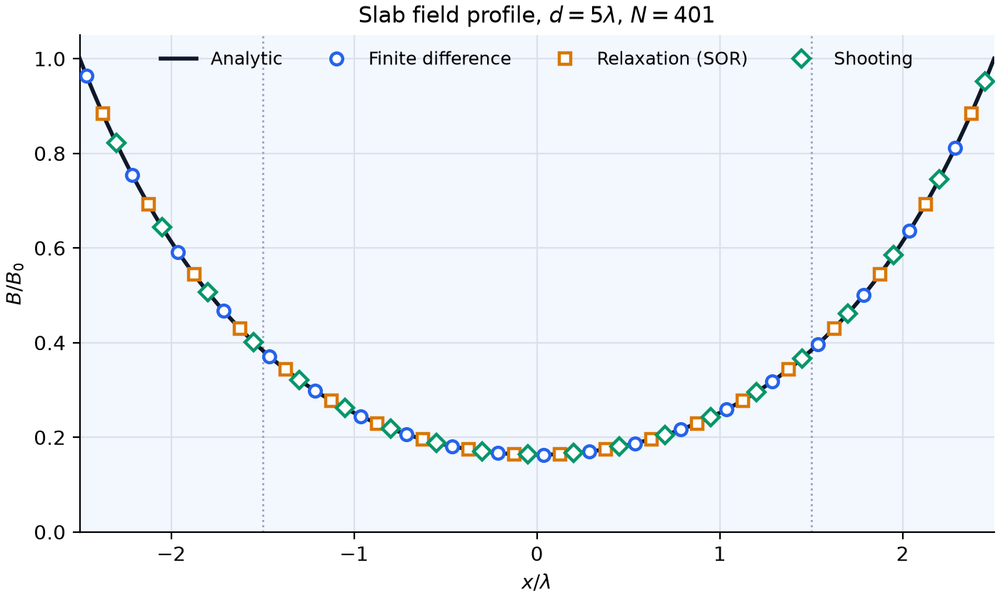
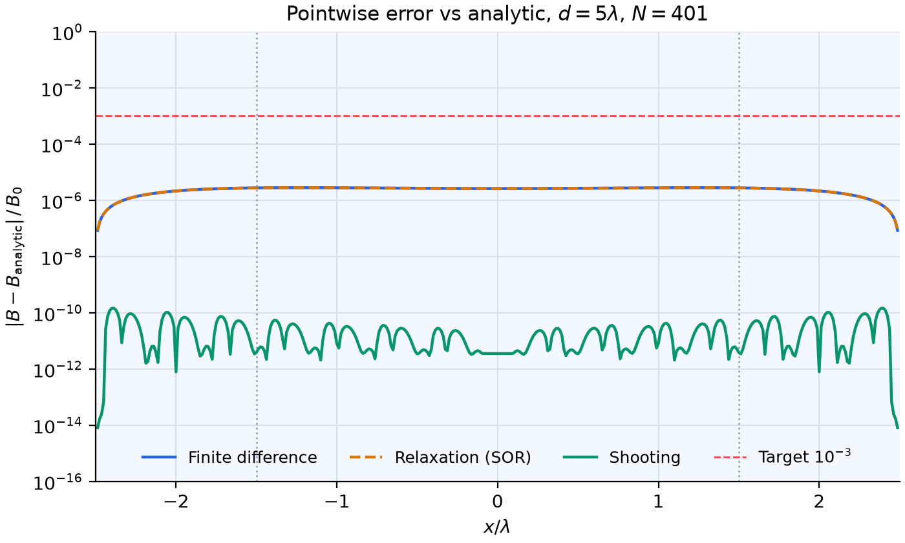

# London Equation: Simulation Techniques for Magnetic-Field Penetration (Q6)

This document supports plan items #6.1 through #6.5 of `Plan.md` and is the
deliverable for issue #1. It records the simulation techniques and the reason
for each choice. PR #11 implements the slab part of the plan: the four
methods are in
[`src/magpenetration_simulation/slab.py`](../src/magpenetration_simulation/slab.py),
the smoke check and figures are in
[`scripts/make_figures.py`](../scripts/make_figures.py), and the interactive
page is in [`src/magpenetration_simulation/app.py`](../src/magpenetration_simulation/app.py).
Section 3 notes where the code departs from the first version of this
document, and why.

## 1. Purpose and scope

A London-equation simulation must show how a static magnetic field decays
inside a superconductor. It must produce the field magnitude $B(x)$ against
position $x$. It must expose the penetration depth $\lambda$ as the length
over which $B$ falls from the boundary value toward zero. It must also show
the temperature dependence of $\lambda$ and the contrast between the slab
and cylinder geometries. Every technique below must reproduce the same
analytic answer. The report covers direct evaluation, finite
differences, relaxation, and shooting. The slab geometry is implemented;
temperature dependence belongs to PR #10, and the cylinder comes later.

## 2. Physics recap

### 2.1 The London equations

The London brothers replaced the current density $J$ of the superconducting
state with two equations [1]:

$$\frac{dJ}{dt} = \frac{n_s e^2}{m}\,E \qquad \nabla \times J = -\frac{n_s e^2}{m}\,B$$

The first equation says that a steady current flows without an electric
field. The second equation ties $\nabla \times J$ to $B$. Ampere's law
$\nabla \times B = \mu_0 J$ then combines with the second equation into
$\nabla^2 B = B/\lambda^2$:

$$\lambda = \sqrt{\frac{m}{\mu_0 n_s e^2}}$$

The expression gives $\lambda$ in meters for $n_s$ in $\text{m}^{-3}$. With
$n_s$ near one carrier per atom, $\lambda$ is of order $20$ to
$40\,\text{nm}$ for conventional superconductors. Tinkham lists
$16\,\text{nm}$ as the London estimate for aluminum and about $50\,\text{nm}$
as the measured value [2]. The penetration depth is a mesoscopic length,
far below the size of a visible sample.

### 2.2 The Meissner effect and the 1D slab solution

The Meissner effect is the expulsion of magnetic flux at the transition to
the superconducting state [3]. That expulsion happens on any path through
the phase diagram. The Meissner state is a thermodynamic equilibrium, so the
final field is the same whether the sample is cooled in the field or the
field is applied after cooling. A perfect conductor is path-dependent
instead: it freezes in whatever flux it held when its resistance vanished.
Because the superconducting state does not depend on its history, the static
solution below describes it for any path, and the simulation needs no time
stepping. A superconductor produces a screening supercurrent in a boundary
layer of thickness $\lambda$. The interior field is zero beyond that layer.
This screening is the effect that the simulation must show.

Consider a slab of thickness $d$ that fills $-d/2 < x < d/2$. An applied
field $B_0$ runs along the slab faces. For a wide slab, the demagnetization
effect is negligible. The field at each face then keeps the value $B_0$.
The boundary conditions read $B(\pm d/2) = B_0$. The 1D form of
$\lambda^2 \nabla^2 B = B$ is $\lambda^2\, d^2B/dx^2 = B$:

$$B(x) = B_0\,\frac{\cosh(x/\lambda)}{\cosh(d/2\lambda)}$$

The coordinate origin $x = 0$ is at the center of the slab. At each face
the solution equals $B_0$. At the center it equals
$B_0/\cosh(d/2\lambda)$. For $d \gg \lambda$ the center is field-free, and
the decay constant near each face is $\lambda$. The screening current
density at each face follows from Ampere's law,
$J = \mu_0^{-1}\,dB/dx = B_0 \tanh(d/2\lambda)/(\mu_0\lambda)$. The same
derivation appears in Kittel [7] and in Poole et al. [8]. The two-fluid
model of Gorter and Casimir gives the law that item #6.4 uses [4]:

$$\lambda(T) = \frac{\lambda_0}{\sqrt{1 - (T/T_c)^4}}$$

The law diverges at $T = T_c$. The simulator must keep $T/T_c$ below $1$.
$\lambda_0$ is the penetration depth at $T = 0$. The slab code uses
$\lambda_0$ directly as $\lambda$ until PR #10 adds $\lambda(T)$.

| Symbol | Definition | Value or unit |
|---|---|---|
| $J$ | supercurrent density | $\text{A}\,\text{m}^{-2}$ |
| $E$ | electric field | $\text{V}\,\text{m}^{-1}$ |
| $n_s$ | superconducting carrier density | $\text{m}^{-3}$ |
| $e$ | elementary charge | $1.602\,176\,634 \times 10^{-19}\,\text{C}$ |
| $m$ | electron mass | $9.109\,383\,7 \times 10^{-31}\,\text{kg}$ |
| $B$ | magnetic flux density | T |
| $\mu_0$ | vacuum permeability | $1.256\,637\,061 \times 10^{-6}\,\text{H}\,\text{m}^{-1}$ |
| $\lambda$ | penetration depth | m |
| $d$ | slab thickness | m |
| $x$ | position from the slab center | m |
| $B_0$ | applied flux density | T |
| $T$, $T_c$ | temperature and critical temperature | K |
| $\lambda_0$ | penetration depth at $T = 0$ | m |
| $a$, $r$ | cylinder radius and radial coordinate | m |
| $u$ | slope variable, $u = dB/dx$ | T/m |
| $\Delta x$ | grid step | m |
| $h$ | dimensionless grid step, $h = \Delta x/\lambda$ | dimensionless |
| $N$ | number of grid points | count |
| $\epsilon$ | relaxation and integration tolerance | dimensionless |
| $\omega$ | over-relaxation factor | dimensionless |
| $\tilde{x}$, $\tilde{B}$, $\tilde{d}$ | dimensionless $x$, $B$, $d$ | dimensionless |
| $\xi$ | coherence length | m |
| $H_{c1}$, $H_c$ | lower and thermodynamic critical fields | A/m |
| $I_0$ | modified Bessel function, order 0 | dimensionless |

### 2.3 Limits of the local London model

The London model treats $J$ at each point as a local response to $E$ and
$B$. That assumption fails in several known cases. Pippard showed that the
cleanest materials have a coherence length $\xi$ above $\lambda$ [5].
The supercurrent then responds to the field over a finite area. The local
model also fails near a face once vortices appear. The vortex state starts
above $H_{c1}$ in a type-II superconductor. Near $T_c$ the order parameter
varies with position. Ginzburg-Landau theory then must replace the fixed
$n_s$ of the London model. The ranges in #4.2 respect these limits.

## 3. Simulation techniques

All four methods share one grid, built by `_grid(d, n_points)`: $N$ evenly
spaced points from $-d/2$ to $d/2$. $N$ must be odd, so a node sits exactly
at $x = 0$; the shooting method of #3.4 relies on that node. Every function
takes SI units and works internally in the dimensionless form of #4.1.

### 3.1 Direct analytic evaluation on a grid

The analytic solution is exact and free of discretization error. It is the
reference for every numerical method. `slab_field_analytic(x, d, lam, b0)`
evaluates it in a form that cannot overflow. The numerator and denominator
of the cosh ratio are both multiplied by $e^{-d/2\lambda}$:

$$B(x) = B_0\,\frac{e^{(x - d/2)/\lambda} + e^{-(x + d/2)/\lambda}}{1 + e^{-d/\lambda}}$$

For $|x| \le d/2$ every exponent is at most zero, so no term can overflow
(#4.4). The function accepts scalars and arrays, because the exponentials
broadcast over the grid. A plot at $d = 10\lambda$ shows a boundary layer of
about $3\lambda$ at each face.

### 3.2 Finite differences and the tridiagonal system

The finite-difference method solves the field equation as a boundary value
problem. Discretize $x$ into $N$ points with step $\Delta x$. At each
interior point $i$, the central difference formula gives

$$\frac{B_{i-1} - 2B_i + B_{i+1}}{\Delta x^2} = \frac{B_i}{\lambda^2}$$

or, with $h = \Delta x/\lambda$ and $\tilde{B} = B/B_0$,
$-\tilde{B}_{i-1} + (2 + h^2)\,\tilde{B}_i - \tilde{B}_{i+1} = 0$. The
result is a tridiagonal system of $N - 2$ unknowns. The known face values
$\tilde{B} = 1$ add to the first and last entries of the right-hand side;
for $N = 3$ both add to the single row. `slab_field_finite_difference`
solves the system with `solve_banded` from SciPy [6] in $O(N)$ time.

The matrix is symmetric and diagonally dominant, because the diagonal
$2 + h^2$ exceeds the sum of the two off-diagonal entries. The direct solve
is stable for any $\Delta x$. The step-size limit familiar from explicit
time stepping of diffusion problems does not apply, because this static
problem has no time step. The error falls as $\Delta x^2$ (#4.3).

### 3.3 Relaxation as a cross-check

The relaxation method solves the same discrete equations by repeated
sweeps, without a matrix solve. It updates each interior point from its two
neighbors. The first version of this document used Jacobi sweeps,

$$\tilde{B}_i \leftarrow \frac{\tilde{B}_{i-1} + \tilde{B}_{i+1}}{2 + h^2}$$

but Jacobi needs about 99,000 sweeps at $N = 401$, because each sweep moves
information by one node. That exceeds the 10,000-sweep cap of the plan.
`slab_field_relaxation` uses red-black successive over-relaxation (SOR)
instead. Each sweep first updates the odd interior nodes, then the even
ones, with

$$\tilde{B}_i \leftarrow (1 - \omega)\,\tilde{B}_i + \frac{\omega}{2 + h^2}\left(\tilde{B}_{i-1} + \tilde{B}_{i+1}\right)$$

The odd nodes read only even neighbors and the even nodes only odd ones, so
each half-sweep is one vectorized NumPy operation. The factor $\omega$ is
the optimal value for this tridiagonal system,
$\omega = 2/\left(1 + \sqrt{1 - \rho^2}\right)$ with
$\rho = 2\cos(\pi/(N-1))/(2 + h^2)$, the convergence rate of plain Jacobi.
A flat start $\tilde{B} = 1$ works. The sweep repeats until the largest
change per sweep drops below $\epsilon = 10^{-10}$, in units of $B_0$, and
raises an error if it reaches `max_sweeps`. At the defaults it converges
in 764 sweeps.

The sweep does not share code with the matrix solve of #3.2. It then can
catch an assembly error in that matrix. The two methods solve the same
discrete equations, so they must agree to within the tolerance; at the
defaults they differ by about $3.5 \times 10^{-9}\,B_0$.

### 3.4 ODE integration and shooting

The shooting method turns the field equation into an initial value problem.
Write the second-order form as a pair of first-order equations,
$dB/dx = u$ and $du/dx = B/\lambda^2$. The first version of this document
started at the left face with an unknown slope $u(-d/2)$ and used a root
finder to adjust it until the field at the right face equalled $B_0$. That
version needs the slope to a relative precision of about $e^{-d/\lambda}$:
its error is $4 \times 10^{-8}$ at $d/\lambda = 20$ and 17 at
$d/\lambda = 40$, and the root finder fails at $d/\lambda = 100$.

`slab_field_shooting` starts at the slab center instead. By symmetry
$dB/dx = 0$ at $x = 0$, so the only unknown starting value is $B(0)$. The
equation is linear, so a wrong guess only scales the whole curve. One
integration of $d^2\tilde{B}/d\tilde{x}^2 = \tilde{B}$ from
$\tilde{B}(0) = 1$, $d\tilde{B}/d\tilde{x}(0) = 0$ out to the face, followed
by division by the face value, gives the exact correction in a single shot.
`solve_ivp` from SciPy [6] integrates the right half of the shared grid
with the eighth-order `DOP853` method at relative tolerance $\epsilon$, and
the result is mirrored onto the left half. Going outward from the center,
the true solution $\cosh(x/\lambda)$ is itself the growing solution, so
nothing small has to be resolved; the error stays near $10^{-10}$ up to
$d/\lambda \approx 1400$ (#4.5).

The trade-off is generality. Linear shooting relies on the equation being
linear and the slab being symmetric. A nonlinear model, such as
Ginzburg-Landau near $T_c$, or different fields on the two faces would need
the root-finding version back. The shooting method does not share an
algorithm with the relaxation sweep. Agreement between the two then confirms
the finite-difference setup of #3.2.

## 4. Numerical practice

### 4.1 Non-dimensionalization

Scale the coordinates before the solver runs. Use $x = \lambda \tilde{x}$
and $B = B_0 \tilde{B}$, with tilde marks for the dimensionless quantities.
The field equation then reads $d^2\tilde{B}/d\tilde{x}^2 = \tilde{B}$ with
$\tilde{B}(\pm \tilde{d}/2) = 1$ and $\tilde{d} = d/\lambda$. The
dimensionless form removes hard units from the solvers. It also keeps every
result reusable across materials. The modules work internally in that form
and reattach $\lambda$ and $B_0$ at the edges.

The figures and the app plot $B/B_0$ against $x/\lambda$ on a linear axis.
In those units the profile depends only on $d/\lambda$: $B_0$ scales the
field out, and $\lambda$ sets the unit of length. Both length scales read
directly off the axis, $\lambda$ as the decay length near each face and $d$
as the span of the shaded slab. A logarithmic axis suits a comparison of
$\lambda$ across materials, which spans orders of magnitude; the slab
profile does not need one. The app also offers a physical view, $x$ in nm
and $B$ in mT, where $B_0$ and $\lambda_0$ change the axes.

The demo default $d = 5\lambda$ keeps the whole cosh profile visible. The
center field is $B_0/\cosh(2.5) \approx 0.163\,B_0$, so both boundary
layers and the reduced interior show on one plot. At $d = 20\lambda$ the
interior is field-free to better than $10^{-4}\,B_0$, and the curve becomes
two thin edges.

### 4.2 Mesh resolution and refinement

$B(x)$ changes on the scale of $\lambda$ near each face. The mesh must
resolve that scale. At a step of $\lambda/8$, the relative truncation error
is about $3 \times 10^{-4}$. At a step of $\lambda/32$, it drops below
$10^{-4}$. A uniform mesh then puts many points into the field-free core at
a large $d/\lambda$.

The code uses a uniform mesh. With $N = 401$ it stays within $10^{-3}$ up
to $d/\lambda \approx 100$, where it has 4 points per $\lambda$. For
$d/\lambda$ above about 10, a graded mesh would spend the same number of
points better by clustering them near the faces. One choice maps a uniform
coordinate $s \in [-1, 1]$ to
$x = (d/2)\tanh(\beta s)/\tanh\beta$. The node spacing then shrinks from the
center to the faces by a factor $\cosh^2\beta$, about 14 for $\beta = 2$.
The finite-difference stencil of #3.2 then needs its non-uniform three-point
form,
$B''_i \approx 2\left[(B_{i+1} - B_i)/h_+ - (B_i - B_{i-1})/h_-\right]/(h_+ + h_-)$,
with $h_\pm$ the spacings to the two neighbors. This is left for a later PR.

| Parameter | Recommended range | Reason |
|---|---|---|
| $d/\lambda$ | $0.5$ to $100$ | covers thin films and bulk slabs |
| points per $\lambda$ | $8$ to $32$ | keeps the max error below $10^{-3}$ |
| total points $N$ | $101$ to $4001$, odd | $O(N)$ work per direct solve |
| $T/T_c$ | $0$ to $0.99$, always below $1$ | $\lambda(T)$ diverges at $T_c$ |
| $B_0$ | $0.01$ to $0.5\,\text{T}$ | keep $B_0$ below $\mu_0 H_{c1}$ (type II) or $\mu_0 H_c$ (type I) |
| $\epsilon$ | $10^{-10}$ | shared by relaxation and shooting |

The London equation is linear, so $B_0$ only scales the solution; its range
matters for physical validity, not for the numerics. The default
$B_0 = 50\,\text{mT}$ lies above $\mu_0 H_c \approx 10\,\text{mT}$ for
aluminum, whose $\lambda$ the default $\lambda_0 = 50\,\text{nm}$ matches
[7]. The scaled profile is unchanged, but a real aluminum slab would leave
the Meissner state at that field.

### 4.3 Convergence and validation

Each technique must converge to the same answer.
[`scripts/make_figures.py`](../scripts/make_figures.py) runs all four
methods at the defaults ($\lambda_0 = 50\,\text{nm}$, $d = 5\lambda$,
$B_0 = 50\,\text{mT}$, $N = 401$), prints the maximum absolute and relative
error of each numerical method, writes the two figures below, and exits
with an error if any relative error exceeds $10^{-3}$:

| Method | max $\lvert\Delta B\rvert$ | max $\lvert\Delta B\rvert / B_0$ |
|---|---|---|
| Finite difference | $1.41 \times 10^{-7}\,\text{T}$ | $2.82 \times 10^{-6}$ |
| Relaxation (SOR) | $1.41 \times 10^{-7}\,\text{T}$ | $2.82 \times 10^{-6}$ |
| Shooting | $7.43 \times 10^{-12}\,\text{T}$ | $1.49 \times 10^{-10}$ |

Finite differences and relaxation share a discretization error that falls
as $\Delta x^2$, because the central formula has error $O(\Delta x^2)$. A
halved mesh must cut that error by about a factor of four:

| $N$ at fixed $d/\lambda = 5$ | measured max error |
|---|---|
| 41 | $2.8 \times 10^{-4}$ |
| 81 | $7.0 \times 10^{-5}$ |
| 161 | $1.8 \times 10^{-5}$ |
| 401 | $2.8 \times 10^{-6}$ |

The exact error depends on $d/\lambda$. The rows show the factor-of-four
trend, which checks the scaling. The shooting error does not depend on the
mesh; it is set by the integrator tolerance $\epsilon$.

### 4.4 Conditioning and stability

The matrix of #3.2 is diagonally dominant for every $\Delta x$ and every
$\lambda$. The direct solve on that matrix is stable. First, `np.cosh`
overflows for arguments above about $710$. The denominator argument
$d/(2\lambda)$ passes that value at $d/\lambda \approx 1420$, and the ratio
then turns into `nan` near the faces. `slab_field_analytic` therefore
evaluates the rescaled form of #3.1, in which every term is at most $1$.
Second, the sweep count of a relaxation method depends on how far
information travels per sweep. Jacobi needs a count of order $N^2$; SOR
needs a count of order $N$, about 764 sweeps at $N = 401$ and 6,800 at
$N = 4001$. The loop caps the count through `max_sweeps` and raises an error
when it trips. Third, a shooting integration follows the growing solution
$\exp(x/\lambda)$. Shooting from the center turns that into an advantage
(#3.4), and the integrator runs at the tight tolerance $\epsilon$.

### 4.5 Where the numerics fail

Even this toy model has edges where a method stops meeting the $10^{-3}$
target. The values below are measured with the code of this PR.

| Method | Limit | Measured |
|---|---|---|
| Finite difference, relaxation | too few points per $\lambda$ | at $N = 401$: $9.5 \times 10^{-4}$ at $d/\lambda = 100$ (4 points per $\lambda$), $3.8 \times 10^{-3}$ at $d/\lambda = 200$; at $N = 41$, $d/\lambda = 100$: $4.1 \times 10^{-2}$ |
| Relaxation | sweep cap | 764 sweeps at $N = 401$, about 6,800 at $N = 4001$, against a cap of 10,000 |
| Shooting from the center | overflow of the unnormalized solution | error near $10^{-10}$ up to $d/\lambda \approx 1400$; above about 1420 the integration fails with an error |
| Shooting from the face (first version) | slope precision of $e^{-d/\lambda}$ | $4 \times 10^{-8}$ at $d/\lambda = 20$, 17 at $d/\lambda = 40$, root finder fails at 100 |
| Analytic | none in range | rescaled form stays finite for any $d/\lambda$ |

The graded mesh of #4.2 would move the first limit to larger $d/\lambda$ at
the same $N$. The physical limits of the London model itself are those of
#2.3.

## 5. Techniques in the planned modules

| Module | Plan item | Techniques |
|---|---|---|
| `slab.py` | #6.2 | analytic solution (#3.1), finite differences (#3.2), relaxation (#3.3), and shooting (#3.4); implemented in PR #11 |
| `cylinder.py` | #6.3 | the same methods with modified Bessel functions ($I_0$, derivative $I_1$) |
| `temperature.py` | #6.4 | the two-fluid law for $\lambda(T)$ [4] with slider-driven plots |
| `visualization.py` | #6.5 | field maps and field lines for the page panels |
| `app.py` | #6.6 | interactive inputs for $T$, $B_0$, $\lambda$, and geometry; the slab page is implemented in PR #11 |

`slab.py` exposes one function per technique: `slab_field_analytic`,
`slab_field_finite_difference`, `slab_field_relaxation`, and
`slab_field_shooting`. `scripts/make_figures.py` compares each numerical
method with the analytic answer; this PR has no pytest suite.
`cylinder.py` repeats the same pattern. The analytic answer for a
cylinder of radius $a$ with an axial field is
$B(r) = B_0\,I_0(r/\lambda)/I_0(a/\lambda)$. The solvers reuse the same
discretization. The cylindrical Laplacian adds a $B'/r$ term to the radial
form. `temperature.py` wraps the law of #2.2 in a function. It
passes $\lambda(T)$ over $T/T_c$ in $[0, 0.99]$ to the geometry functions.
`visualization.py` draws the field map of each page.
Each page draws its own Material and field card, and that card sets $T$, $T_c$,
$\lambda_0$, and $B_0$.
The page also sets the size and $N$.
The display updates while a slider moves.

## 6. What was done and why

The body of issue #1 contains the line: "Add comments on what you have done
and why." This document makes those comments at the level of simulation
techniques. The answer has three parts. First, it records the physics and
the analytic solution of #2. Every numerical step needs that reference
answer. Second, it records four techniques in #3 with the numerical
practice of #4 beside them. The implementers then do not need to rediscover
the mesh, scaling, and stability choices. Third, it maps the techniques
onto the planned modules in #5. Reviewers then can check each module of
#6.2 through #6.6 against the plan. The first version of this document
changed no source code. PR #11 then implemented the slab part of #6.2 and
the slab page of #6.6. Where the implementation departs from the first
version, section 3 says so: the overflow-safe analytic form, SOR in place
of Jacobi sweeps, and linear shooting from the center in place of shooting
from a face.

## 7. Caveats

The London model holds in a fixed window. It assumes a local response and a
static field. The simulators must keep $d/\lambda$ and the applied field in
the ranges of #4.2. They must mark the two-fluid curve as a model law in
every plot caption. The failures of #2.3 apply outside the window, and the
numerical limits of #4.5 apply inside it. For #6.3, the Bessel answer is
exact only for an axial field on a cylinder. A transverse field needs a
numerical treatment beyond this plan.

## References

1. London, F., London, H. "The electromagnetic equations of the
   supra-conductor." *Proceedings of the Royal Society A*, 149(866),
   71-88, 1935. DOI: `10.1098/rspa.1935.0048`.
2. Tinkham, M. *Introduction to Superconductivity*. 2nd ed. McGraw-Hill,
   1996 (Dover reprint, 2004), ch. 1.
3. Meissner, W., Ochsenfeld, R. "Neue Effekte bei Eintritt der
   Supraleitung." *Naturwissenschaften*, 21, 787-788, 1933.
4. Gorter, C. J., Casimir, H. B. G. "On the theory of superconductivity."
   *Physica*, 1, 306-320, 1934.
5. Pippard, A. B. "The coherent length of superconductors." *Proceedings of
   the Royal Society A*, 216, 547-568, 1953.
6. Virtanen, P., Gommers, R., Oliphant, T. E., et al. "SciPy 1.0:
   fundamental algorithms for scientific computing in Python."
   *Nature Methods*, 17, 261-272, 2020. DOI: `10.1038/s41592-019-0686-2`.
7. Kittel, C. *Introduction to Solid State Physics*. 8th ed. Wiley, 2005,
   ch. 10.
8. Poole, C. P., Jr., Farach, H. A., Creswick, R. J., Prozorov, R.
   *Superconductivity*. 2nd ed. Academic Press (Elsevier), 2014.
