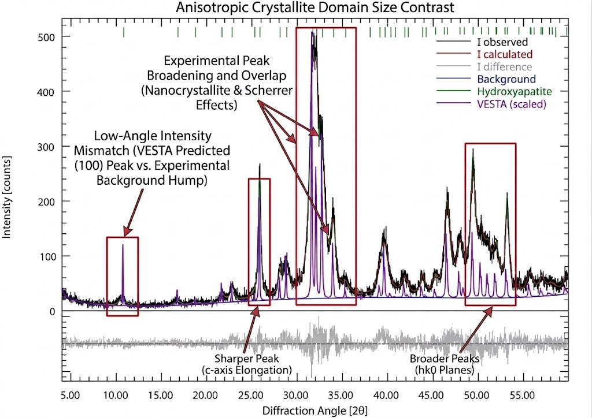

# Understanding X-Ray Diffraction Patterns: A Comparison of Experimental Data and Theoretical Simulations

In this report, we will compare an experimental XRD pattern of Hydroxyapatite, $\text{Ca}_5(\text{PO}_4)_3(\text{OH})$, analyzed using Profex (Rietveld refinement), against a theoretical pattern simulated in VESTA.

Before diving into the results, it might be useful to gloss over the various non-idealities in experimental data that might cause disagreements between the experimental fit and the Vesta graph.

## 1. Key Concepts in X-Ray Diffraction

When software like VESTA simulates an XRD pattern, it imagines a “perfect” crystal of infinite size. In the real world, materials have imperfections that change the shape and size of the diffraction peaks.

- **Crystallite Size and Peak Broadening:** In a real powder sample, the material is made up of tiny crystalline grains (nanocrystals). When these grains are very small, the X-ray diffraction peaks become wider (broadened). This relationship is described by the **Scherrer effect**: the smaller the crystallite, the broader the peak. VESTA does not account for this and assumes infinitely large crystals, resulting in artificially narrow, needle-like peaks. Basically, smaller dimensions will cause broadening of peaks.
- **Anisotropic Growth:** Crystals rarely grow as perfect spheres; they often grow as needles, rods, or plates. This means a single crystallite will have different dimensions depending on the direction you measure it. As a result, peaks corresponding to the “long” side of the crystal will appear sharper, while peaks corresponding to the “short” side will appear broader.
- **Microstrain:** Inside real crystals, the atoms are not always perfectly spaced. Defects and stresses can cause slight squeezing or stretching of the lattice planes. This variation in spacing causes the diffracted X-rays to spread out slightly, further broadening the peaks.
- **Instrumental Effects:** A real X-ray diffractometer has moving parts, slits to control the beam, and background “noise” from the air and sample holder. A simulated pattern assumes a perfect machine operating in a vacuum with zero background noise.

---

## 2. Overview of the Hydroxyapatite Sample

Using the Profex software, we matched our experimental data (`ex2-file1.xy`) to the known structure of Hydroxyapatite. The refined model was then exported to VESTA to generate the simulated pattern.

Here are the key structural parameters determined from the Profex refinement:

- **Crystal System:** Hexagonal (Space Group $P6_3/m$). This tells us the fundamental shape of the unit cell is a prism with a hexagonal base.
- **Unit Cell Dimensions:**
    - $a = b = 9.4561$ Å (the width of the hexagonal base)
    - $c = 6.8848$ Å (the height of the cell)
- **Crystallite Size (Anisotropic):**
    - Size along the vertical $c$axis $[001] = 26.14\text{ nm}$
    - Size along the horizontal $a$axis $[100] = 10.48\text{ nm}$
    - *Takeaway:* The crystals are rod-like, being more than twice as long as they are wide.

---

## 3. Agreement in Peak Positions ($2\theta$)

If you place the VESTA pattern and the Profex pattern over one another, the first thing you will notice is **excellent agreement in the horizontal positions** of the peaks.

**Why do they match so well?**
The position of a diffraction peak is dictated entirely by **Bragg’s Law** ($n\lambda = d_{hkl}$), which depends on the distances between the atomic planes ($d$-spacing). Because the VESTA simulation was built using the exact same unit cell dimensions ($a$ and $c$) calculated by Profex, the interplanar distances are identical in both models. Therefore, every fundamental Bragg reflection occurs at the exact same angle ($2\theta$) in both patterns.

---

## 4. Comparison of Major Diffraction Features

The table below is a thorough comparison of the theoretical simulation (VESTA) versus the real experiment (Profex).

| Miller Indices $(hkl)$ | Position ($2\theta$) | VESTA (Simulation) | Profex (Experimental) | Notes                                                                                                                                                                                          |
| --- | --- | --- | --- |------------------------------------------------------------------------------------------------------------------------------------------------------------------------------------------------------------|
| **(100)** | $10.80^\circ$ | Sharp, very prominent | Extremely broad, weak hump | *Major discrepancy.* We will explore this low-angle anomaly in detail in Section 6.                                                                                                                        |
| **(002)** | $25.88^\circ$ | Sharp peak | Relatively sharp, tall peak | Because the crystal is larger along the $[001]$ direction ($26.14\text{ nm}$), peaks related to this direction suffer less broadening.                                                                     |
| **(211)** | $31.74^\circ$ | Distinct spike (100% max intensity) | Forms the apex of a broad cluster | The primary peak for Hydroxyapatite. In the experiment, it overlaps heavily with neighboring peaks.                                                                                                        |
| **(112)** | $32.18^\circ$ | Distinct peak beside (211) | Merged into the side of (211) | VESTA’s narrow theoretical peaks keep these separate. Real-world crystallite size broadening smears them together.                                                                                         |
| **(300)** | $32.88^\circ$ | Distinct peak | Broad right-hand shoulder | Because the crystal is narrow along $[100]$ ($10.48\text{ nm}$), this peak is heavily broadened.                                                                                                           |
| **(004)** | $53.15^\circ$ | Weak sharp peak | Broad, overlapped cluster | Unlike the isolated (002) peak, this reflection overlaps with adjacent planes in the experimental data, masking the sharpness expected from the $c$-axis elongation.                                       |
| **High-angle $(hk0)$ reflections** | $\sim 48^\circ - 52^\circ$ | Distinct, separate sharp peaks | Broadened, overlapping profiles | Reflections from the multiple $(hk0)$ planes in this region suffer from severe Scherrer broadening due to the narrow crystallite width ($10.48\text{ nm}$), making them visibly wider than $c$-axis peaks. |

---

## 5. General Differences: Theory vs. Reality

While the peak positions line up perfectly, the visual “shape” of the patterns differs in a few highly educational ways:

1. **Resolution and Peak Overlap:**
VESTA draws every peak using an idealized, uniformly narrow mathematical curve. Because of this, peaks that are close together (like the famous Hydroxyapatite “triplet” at $31.74^\circ$, $32.18^\circ$, and $32.88^\circ$) are neatly separated with clear gaps between them. In the real Profex data, the small physical size of the nanocrystals causes Scherrer broadening which is caused by the finite crystal sizes as we discussed earlier. The peaks spread out so much that they bleed into one another, forming one massive, envelope over the theoretical peaks.
2. **Directional (Anisotropic) Peak Shapes:**
Because VESTA applies the same narrow shape to every peak, it ignores the physical shape of the crystal. The experimental Profex data captures reality: peaks reflecting off the long axis of the rod-shaped crystals, such as $(002)$ and $(004)$, remain relatively tall and narrow, this can be explained by the larger dimension of the crystals along the vertical axis (26.14nm) compared to the horizontal axis (10.48nm). Conversely, peaks reflecting off the narrow width of the rods, such as $(300)$, get squashed into wide, low humps.
3. **Background Noise:**
The VESTA pattern sits on a perfectly flat baseline of zero as . The Profex pattern sits on a curving background of “noise” (around 15 to 30 counts). This is because real X-rays scatter off the air in the machine and create background interference, which the software accounts for while fitting a particular phase with the experimental data.

---

## Major Discrepancy at $2\theta \approx 10.8^\circ$

One of the most striking differences between the two patterns occurs at the very beginning of the scan, near $2\theta \approx 10.8^\circ$ (which corresponds to a Bragg angle of $\theta \approx 5.4^\circ$).

In VESTA, the $(100)$ peak here is a **sharp, prominent spike** reaching nearly a quarter of the height of the maximum peak. However, in the experimental Profex data, this peak is just a **barely noticeable bump** slightly above the background noise. Interestingly, the Rietveld calculated fit (the red line in Profex) matches this depressed weak bump perfectly, meaning the experimental software *understands* why it is so weak. VESTA drastically overestimates it.

Why does this happen? To fully understand this, we must look beyond the crystal dimensions and consider how the machine itself collects data.

### The Limitation of Scherrer Broadening

As discussed in earlier sections, we know that the $(100)$ peak corresponds to diffraction along the narrowest dimension of the crystallite ($10.48\text{ nm}$). The Scherrer effect dictates that this small dimension causes severe peak broadening. Because the total area under the peak (integrated intensity) must be conserved, spreading this area over a wider angular range naturally reduces the maximum *height* of the peak.

However, while this broadening flattens the profile, **it is not enough to explain the massive discrepancy** observed here. Even if we account for the flattened shape, the total amount of diffracted X-rays (the integrated area) in the experimental data at this low angle is still vastly lower than what VESTA predicts.

### The Primary Non-Trivial Cause: The Instrument's "Eye" (Divergence Slits)

The true cause of this massive drop in intensity is a non-trivial instrumental effect. X-ray machines use metal slits to focus the beam onto the sample.

- **VESTA's Assumption:** Standard simulations usually assume a fixed slit, which means at very low angles (like $10.8^\circ$), the X-ray beam spreads out massively, leading to mathematical formulas that artificially boost the predicted intensity at these low angles.
- **The Real Experiment:** The Profex refinement accounts for the specific hardware used, an **Automatic Divergence Slit (ADS)**. As the machine moves to very low, shallow angles, it automatically closes the slit to keep the X-ray beam perfectly focused within the $10\text{ mm}$ sample area. By restricting the beam to prevent it from spilling over the edges of the sample holder, the machine physically measures fewer X-rays at this low angle.

Because Profex knows the slit was closing, it accurately predicts a weak peak. Because VESTA does not know about the machine's hardware, it blindly predicts a massive peak based on simplified geometry.